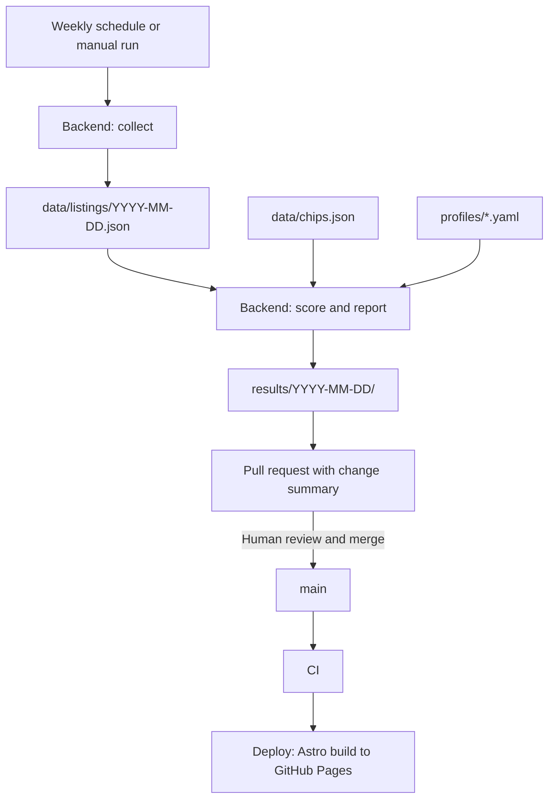

# mac-value-index

Which Apple silicon Mac gives the most development capability per £ in the
UK right now, new or refurbished?

A Node.js pipeline researches UK prices and benchmarks, calculates the
rankings and commits the results. A static Astro site presents them on
GitHub Pages: <https://martinmayer-tech.github.io/mac-value-index/>

The full specification is in [`docs/`](docs/):
[system overview](docs/mac-value-index-system-overview.md),
[backend](docs/mac-value-index-backend.md) and
[frontend](docs/mac-value-index-frontend.md).

## How it fits together



- The backend does all research and all calculation.
- The frontend is a static view of `results/`. It has no scoring logic, no
  price data of its own and makes no network requests at runtime.
- The contract between them is `packages/contracts`: zod schemas for every
  data file. Neither app imports the other.

## Repository layout

| Path                 | What it is                                         | Written by |
| -------------------- | -------------------------------------------------- | ---------- |
| `apps/backend`       | Research and calculation pipeline (CLI)            | humans     |
| `apps/web`           | Astro static site                                  | humans     |
| `packages/contracts` | zod schemas and inferred types for every data file | humans     |
| `packages/config`    | Shared TypeScript, ESLint and Prettier config      | humans     |
| `data/`              | `chips.json` and one listing snapshot per run      | backend    |
| `profiles/`          | Scoring weight profiles (YAML)                     | humans     |
| `results/`           | Pre-calculated rankings, report and CSV per run    | backend    |

## Getting started

Requires the Node.js version in `.nvmrc` and pnpm (version pinned in
`package.json`).

```bash
pnpm install
```

```bash
pnpm check
```

`pnpm check` runs lint, the format check, type-checking and the unit tests
with coverage thresholds.

To run everything CI runs, in the same order and from a clean tree:

```bash
pnpm ci:local
```

```bash
pnpm ci:local --fast
```

`--fast` skips Lighthouse and the Playwright suite. The first time, install
the Playwright browser with
`pnpm --filter web exec playwright install chromium`. The dependency review
and conventional-commit checks on pull requests are the only CI steps that
do not run locally; the commit hook covers commit messages.

A pre-push hook runs `pnpm ci:local --fast` before every push.

### Backend

```bash
pnpm backend run
```

| Command                                  | Reads                               | Writes                                          |
| ---------------------------------------- | ----------------------------------- | ----------------------------------------------- |
| `pnpm backend collect [--source <id>]`   | live sources                        | `data/listings/YYYY-MM-DD.json`, `.cache/`      |
| `pnpm backend validate`                  | `data/`, `profiles/`, `results/`    | nothing (exit code)                             |
| `pnpm backend score [--snapshot <date>]` | snapshot, `chips.json`, `profiles/` | `results/<date>/results.json`, `index.json`     |
| `pnpm backend report [--snapshot <d>]`   | `results.json`                      | `report.md`, `ranking.csv`                      |
| `pnpm backend diff <from> <to>`          | two snapshots and results           | change summary on stdout (or `--output <file>`) |
| `pnpm backend run`                       | everything                          | all of the above, in order                      |

Exit codes: 0 success, 1 error, 2 validation failure, 3 anomaly guard
failure (outputs are still written). See
[`apps/backend/README.md`](apps/backend/README.md) for adding a source
adapter or a profile.

### Frontend

```bash
pnpm build
```

```bash
pnpm --filter web preview
```

The site is served under `/mac-value-index/`, as on GitHub Pages.

Site checks, run against the built site:

```bash
pnpm --filter web check:links
```

```bash
pnpm --filter web check:html
```

```bash
pnpm --filter web check:lighthouse
```

End-to-end tests run against a build of the test fixture:

```bash
MVI_RESULTS_DIR=test/fixtures/site/results pnpm --filter web build
```

```bash
pnpm test:e2e
```

## Data status: read before relying on the ranking

- **Prices** come from the Apple UK store (new and Certified Refurbished)
  through structured adapters that read schema.org JSON-LD and the store's
  embedded product data. Every listing links to its source page.
- **Benchmarks are not yet verified.** Geekbench blocks automated access
  and its `robots.txt` excludes AI agents, so it is not scraped. The
  figures in `data/chips.json` were collected by a research agent from
  search-result snippets of Notebookcheck, EveryMac, Tom's Guide and Apple
  pages. They are marked `collectedBy: agent`, the sources are mixed, and
  they need a human check against the linked pages.
- **Some chips have no citable Geekbench 6 Metal score** (M4 8/8, M5 Pro
  15/16, M5 Max 18/32, both M5 Ultra variants, M6 10/10). Figures are never
  estimated, so listings with those chips are excluded and listed with the
  reason. Filling those values in `data/chips.json` brings them into the
  ranking.
- **Third-party refurbishers and retailers are not collected yet.** The
  proposal awaiting approval is in
  [`docs/source-proposal.md`](docs/source-proposal.md).

## Engineering standards

TypeScript follows the Google TypeScript Style Guide, with the strict
compiler options listed in the system overview in
`packages/config/tsconfig.base.json`.

Deviations, recorded as the specification asks:

- **gts is not a dependency.** gts 7 pins ESLint 9, which is no longer
  supported, and the eslint-plugin-astro release for Astro 7 needs ESLint 10. The gts lint rules and its Prettier settings are applied by hand in
  `packages/config/eslint.js` and `packages/config/prettier.js`.
- **eslint-plugin-jsx-a11y** declares a peer range that stops at ESLint 9.
  It runs correctly on ESLint 10; pnpm prints a peer warning.
- **TypeScript 6**, not 7: typescript-eslint and `astro check` do not yet
  support TypeScript 7.
- **Theme toggle without JavaScript.** The site must have zero client
  JavaScript outside the ranking island, so the manual theme toggle is
  CSS-only. It follows the system setting by default; a manual choice
  applies to the current page and is not remembered between pages.
- **Value score scale.** The value score is the capability score (zero to 100) per £1,000, so the numbers are readable. The ranking order is the
  same as capability divided by price.
- **Node.js 22** is pinned because it is the LTS line this was built and
  tested on. Astro 7 needs 22.23.4 or later.

Other conventions: British English, dates as YYYY-MM-DD, prices in GBP
including VAT, lowercase hyphenated file names, conventional commits
(checked by a commit hook and in CI), and no `eslint-disable` without a
written reason.

## CI/CD

| Workflow       | Trigger                                | What it does                                                                                                                                              |
| -------------- | -------------------------------------- | --------------------------------------------------------------------------------------------------------------------------------------------------------- |
| `ci.yml`       | pull requests, pushes to `main`        | Lint, type-check, test with coverage, validate data, determinism check, build, site checks (links, HTML, axe, Lighthouse), security. Each blocks the next |
| `research.yml` | Mondays 06:00 UTC, or manual           | Runs the backend and opens a `research/YYYY-MM-DD` pull request with a change summary. Never pushes to `main`, never deploys                              |
| `deploy.yml`   | after CI succeeds on `main`, or manual | Builds the site, deploys to GitHub Pages, smoke-tests the live URL                                                                                        |

Notes:

- Third-party actions are pinned to full commit SHAs. Every job has a
  timeout and minimum permissions.
- The built site is uploaded as the `site` artifact on every CI run, for
  review on pull requests.
- A research run that fails opens or updates one tracking issue. A guard
  failure still opens the pull request, labelled `needs-attention`.
- Pull requests opened with the default `GITHUB_TOKEN` do not trigger other
  workflows. To have CI run on research pull requests automatically, give
  `research.yml` a fine-grained token or GitHub App token; otherwise close
  and reopen the pull request to start CI.
- The research workflow needs no secret today. If an agent adapter is
  added, store its API key as a repository secret and pass it to the
  research job only.

### Rollback

Revert the offending commit on `main` through a pull request. CI runs and
`deploy.yml` redeploys the previous state. `deploy.yml` can also be run by
hand to redeploy `main`.

## Repository settings (set by a human)

- **Pages**: Settings → Pages → Source: "GitHub Actions".
- **Branch protection on `main`**: pull request required, the `ci.yml`
  checks required, linear history, no force pushes.
- **CODEOWNERS** review on `data/`, `results/`, `profiles/` and
  `packages/contracts/` (see `.github/CODEOWNERS`).
- **Actions**: Settings → Actions → General → allow GitHub Actions to
  create pull requests (needed by `research.yml`).
- **Dependabot** is configured in `.github/dependabot.yml`: npm and GitHub
  Actions, grouped weekly.

## Licence

Apache-2.0. See [`LICENSE`](LICENSE).
