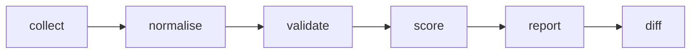

# mac-value-index: backend component

The backend researches UK Mac prices and benchmarks, calculates the value
rankings and writes pre-calculated result files. Read
`mac-value-index-system-overview.md` first for the architecture, contract,
shared standards and CI/CD.

## Responsibilities

In scope:

- Collect listings and prices from UK sources.
- Maintain chip specifications and benchmark scores.
- Normalise and validate all data.
- Calculate every metric, score, ranking and summary the site displays.
- Generate the markdown report and CSV.
- Produce a change summary between snapshots.

Out of scope:

- Any presentation or HTML.
- Running as a hosted service. It is a CLI that runs locally and in
  GitHub Actions.

## Stack

- TypeScript (strict, ESM) on Node.js LTS, in `apps/backend`.
- zod schemas imported from `packages/contracts`.
- Native `fetch` for HTTP. `cheerio` for HTML parsing. `yaml` for
  profiles. `node:util` `parseArgs` for the CLI.
- vitest for tests.
- Keep dependencies minimal and justify each in the README.

## Pipeline



Each stage is a separate CLI command, reads files and writes files, and
can be run on its own:

| Command | Reads | Writes |
|---|---|---|
| `pnpm backend collect [--source <id>]` | live sources | `data/listings/YYYY-MM-DD.json`, raw responses in `.cache/` |
| `pnpm backend validate` | `data/`, `profiles/`, `results/` | nothing (exit code) |
| `pnpm backend score [--snapshot <date>]` | snapshot, `chips.json`, `profiles/` | `results/YYYY-MM-DD/results.json`, `results/index.json` |
| `pnpm backend report [--snapshot <date>]` | `results.json` | `report.md`, `ranking.csv` |
| `pnpm backend diff <from> <to>` | two snapshots and results | change summary markdown on stdout |
| `pnpm backend run` | everything | all of the above, in order |

Code layout:

```
apps/backend/src/
├── cli/            # argument parsing and stage wiring only
├── collect/
│   ├── adapters/   # one file per source
│   ├── http.ts     # fetch wrapper: rate limit, retry, cache, user agent
│   └── normalise.ts
├── scoring/        # pure functions, no I/O, no clock, no randomness
├── report/         # markdown and CSV rendering
├── diff/
└── io/             # all file reads and writes
```

## Stage 1: collect (research)

### Scope of machines

- Every Apple silicon Mac currently sold new by Apple UK, across the
  chip, memory and storage configurations that matter.
- Apple UK Certified Refurbished listings.
- Reputable UK third-party refurbishers (graded stock, 12-month warranty
  minimum), covering older generations back to M1 Max and M1 Ultra.
- Best current price from reputable UK retailers for new machines,
  recorded separately from RRP.

### Source adapters

Every source implements one interface:

```ts
interface SourceAdapter {
  readonly id: string;
  readonly kind: 'structured' | 'agent';
  readonly condition: Condition;
  collect(context: CollectContext): Promise<readonly RawListing[]>;
}
```

Two kinds of adapter:

1. **Structured adapters** (preferred): deterministic fetch and parse.
   Prefer machine-readable data embedded in pages (for example
   schema.org JSON-LD product and offer blocks) over scraping visible
   markup.
2. **Agent adapters** (fallback): for sources with no stable structure,
   use an LLM research agent with web search to extract listings into
   the same `RawListing` shape. Requirements:
   - Check the provider's current documentation for the SDK, model and
     tool names. Do not rely on training data.
   - The agent must return a source URL and the exact price text it read
     for every listing.
   - Output is validated by the same schemas as structured adapters.
   - Agent-collected listings are flagged `collectedBy: 'agent'` and
     highlighted in the pull request for human checking.
   - The API key comes from an environment variable. The adapter is
     skipped, with a warning, when the key is absent.

Start with structured adapters for Apple UK (new and refurbished). Propose
the list of third-party sources and the adapter kind for each, and wait
for my approval before building them.

### Collection rules

- Respect each site's `robots.txt` and terms of use. If a source
  disallows automated access, do not collect from it; report it instead.
- Identify with a descriptive user agent. Rate limit to one request per
  second per host. Retry with backoff, three attempts maximum.
- Cache raw responses in `.cache/` (ignored by git) keyed by URL and
  date, so re-runs do not re-fetch.
- A failing adapter must not fail the run. Record the failure in the
  snapshot's `sourceStatus` and continue.
- Never invent or estimate a value. If a field cannot be read, set it to
  `null` with a `note`, or drop the listing.

### Listing snapshot: `data/listings/YYYY-MM-DD.json`

Per listing: stable `id`, model, year, form factor, chip variant id, RAM
(GB), SSD (GB), condition (`new` | `apple-refurbished` |
`third-party-refurbished`), grade, warranty months, price (GBP including
VAT), RRP where applicable, seller, source URL, retrieved date,
`collectedBy`, `note`.

Per snapshot: `schemaVersion`, snapshot date, `sourceStatus` for every
adapter (ok, failed, skipped; listing count; error).

Normalisation:

- Map every listing to a chip variant in `chips.json` by CPU and GPU
  core counts. An unmapped listing fails validation.
- De-duplicate identical configurations from the same seller. Keep
  distinct sellers as separate listings.
- Listing `id` is a stable hash of seller, model, chip variant, RAM, SSD
  and condition, so snapshots can be compared.

### Chip data: `data/chips.json`

Per chip variant: id, family, generation, CPU cores (performance and
efficiency), GPU cores, Geekbench single-core, multi-core and Metal
scores, memory bandwidth (GB/s), maximum memory, source URLs, retrieved
date.

- Use ONE Geekbench version throughout. Never mix versions. Record the
  version at file level.
- This file changes rarely. Update it by hand or with an agent adapter,
  always through a reviewed pull request.

### Anomaly guards

Run after collection, comparing with the previous snapshot. Each guard
fails the stage with a clear message:

- Total listing count fell by more than 20%.
- Any single price moved by more than 30%.
- Any source that returned listings last time returned zero.
- Fewer than 40 listings in total.
- Any listing without a source URL or retrieved date.
- Any price that is zero, negative or not a whole number of pence.

## Stage 2: score (calculations)

All scoring lives in `apps/backend/src/scoring/` as pure functions: no
file access, no network, no clock, no randomness. The snapshot date comes
from the data, never from the system time.

### Derived metrics, per listing

- **Processing**: multi-core, single-core and Metal scores from the chip
  variant.
- **Model memory headroom (GB)**: RAM minus a reservation for macOS,
  Docker and Xcode (default 12 GB). Map to the largest model class that
  fits at 4-bit quantisation (for example 7B, 14B, 32B, 70B, 120B+). The
  mapping table lives in the profile, with its assumptions documented.
- **Usable storage (GB)**: SSD minus a baseline for macOS, Xcode,
  simulators and Docker images (default 150 GB).
- **Unit costs**: £ per 1,000 multi-core points, £ per GB RAM, £ per GB
  usable storage.

### Scores

- **Capability score**: weighted sum of normalised metrics. Normalise
  each metric against the best value in the snapshot (zero to one).
  Document the normalisation method and apply it identically everywhere.
- **Value score**: capability score divided by price. This is the
  ranking key. Ties break on higher capability score, then lower price,
  then listing id.

### Profiles: `profiles/*.yaml`

Each profile defines weights (summing to 100), reservations, floors and
the model-class mapping. Three profiles ship:

| Profile | Multi-core | Memory headroom | GPU and bandwidth | Single-core | Usable storage |
|---|---|---|---|---|---|
| `secondary-dev-llm` (default) | 30 | 35 | 15 | 10 | 10 |
| `cpu-heavy` | 50 | 15 | 5 | 20 | 10 |
| `memory-heavy` | 15 | 55 | 15 | 5 | 10 |

Default floors: minimum 16 GB RAM and 512 GB SSD. Listings below a floor
are excluded and recorded with the reason.

### Also calculate

- Top 10 per profile.
- Pareto frontier of price against capability score, per profile.
- Best pick per price band: under £1,000, £1,000–£2,000, £2,000–£3,500,
  over £3,500.
- Stability: which listings appear in the top 10 under all three
  profiles.
- Storage sensitivity for desktops: re-score assuming a 2 TB external
  Thunderbolt SSD at a researched UK price (recorded with its source in
  the profile).
- New versus refurbished: for each configuration available in more than
  one condition, the saving in £ and per cent.
- One plain-English summary line per ranked listing, in this form:
  "Mac mini M4 Pro 48GB 1TB (Apple refurbished) is £X, scores A
  multi-core, runs models up to B, and stores C GB usable."
- A conclusion: the single best option and why, in three sentences or
  fewer, generated from a template and the calculated figures only.

### Output: `results/YYYY-MM-DD/results.json`

Contains everything above, plus the inputs needed to explain it:
`schemaVersion`, snapshot date, Geekbench version, profile definitions as
used, every ranked listing with all derived metrics and score components,
exclusions with reasons, sources and `sourceStatus`.

Rules:

- Numbers are stored unformatted. Rounding for display is the frontend's
  job, except in `report.md`.
- Keys and arrays are written in a stable order, with fixed JSON
  formatting, so output is byte-identical between runs.
- `results/index.json` lists every snapshot date and marks the latest.

## Stage 3: report

`results/YYYY-MM-DD/report.md`, generated from `results.json` only:

1. Conclusion first.
2. Top 10 table for the default profile: rank, model, chip, RAM, SSD,
   condition, price, multi-core score, model headroom, usable storage,
   value score.
3. One plain-English line per top-10 entry.
4. Best pick per price band.
5. New versus refurbished.
6. Sensitivity and stability results.
7. Methodology: formulas, weights, reservations, Geekbench version.
8. Caveats: benchmark limits, stock volatility, warranty differences,
   display and peripherals excluded from desktop prices.
9. Sources with retrieval dates, and any sources that failed.
10. Appendix: full ranked list and exclusions.

`results/YYYY-MM-DD/ranking.csv`: full ranking for the default profile.

## Stage 4: diff

Compare two snapshots and their results. Output markdown for the research
pull request description:

- Listings added and removed.
- Price changes, largest first.
- Movement in the top 10 for the default profile.
- Change of overall winner, stated at the top if it occurred.
- Sources that failed or were skipped.
- Agent-collected listings that need a human check.

## Testing

- Unit tests for every scoring function, including edge cases: `null`
  fields, ties, listings below floors, a single listing, weights that do
  not sum to 100 (must be rejected).
- Property-based tests where they fit: for example, lowering a price
  never lowers a value score; adding a listing never changes another
  listing's derived metrics.
- Adapter tests run against recorded fixtures committed under
  `apps/backend/test/fixtures/`. Tests never touch the network.
- A golden-file test: a small fixed snapshot produces an exact expected
  `results.json` and `report.md`.
- Coverage thresholds as set in the system overview.

## CI/CD touchpoints

Defined in full in the system overview. The backend must support them:

- `validate` returns a non-zero exit code on any schema failure.
- `score` is deterministic, so CI can re-run it and compare with the
  committed files.
- `run` exits zero when individual adapters fail, and non-zero only when
  an anomaly guard fails or no source succeeds. The exit reason is
  written to the GitHub Actions job summary.
- `diff` output is written to a file the research workflow uses as the
  pull request description.
- No secret is ever logged. Agent adapters are skipped without a key.

## Definition of done

- A full local run produces a snapshot, results, report and CSV.
- All tests pass, coverage thresholds met.
- Running `score` twice gives byte-identical output.
- Every listing in the top 10 has a source URL that I can open and that
  shows the stated price.
- The README documents how to add a source adapter and a profile.
