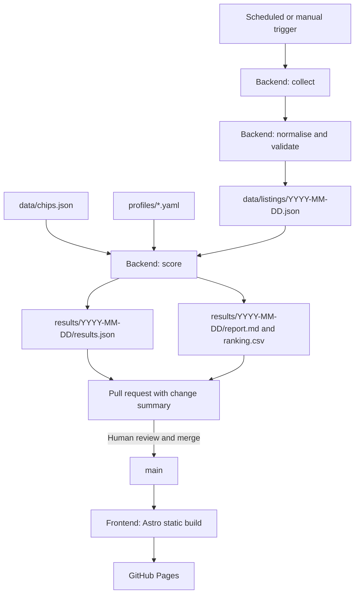

# mac-value-index: system overview

Read this document first. It defines how the two components fit together,
the contract between them, the shared engineering standards and the CI/CD
requirements. Component detail lives in:

- `mac-value-index-backend.md`: research and calculation pipeline.
- `mac-value-index-frontend.md`: static Astro site.

## Purpose

Answer one question with evidence: "Which Apple silicon Mac gives the most
development capability per £ in the UK right now, new or refurbished?"

Use case to optimise for (the default profile, `secondary-dev-llm`):

- A secondary development machine, not a daily driver.
- Workloads: Docker (multiple containers), Xcode builds and simulators,
  and several local LLMs.
- High unified memory is a bonus, not a hard requirement.
- Desktops and laptops are both in scope.

Output: the best 10 configurations, with the reasoning and sources, as a
published website and a downloadable markdown report.

## Architecture principles

1. **The backend does all research and all calculation.** It produces
   versioned, pre-calculated result files.
2. **The frontend is a static representation of those results.** It
   contains no scoring logic, no price data of its own and no network
   calls at runtime.
3. **The contract between them is a set of schema-validated JSON files**
   committed to the repository. Neither component imports the other's
   code.
4. **Every published figure is traceable** to a source URL and a
   retrieval date.
5. **Deterministic calculation.** The same snapshot and profiles always
   produce byte-identical results.
6. **Research changes reach `main` only through a reviewed pull
   request.** No unattended price data is published.

## How it fits together



There is no server at runtime. "Backend" means a Node.js pipeline that
runs in GitHub Actions (and locally), not a hosted service. GitHub Pages
serves static files only.

## Repository structure

pnpm workspace monorepo:

```
mac-value-index/
├── apps/
│   ├── backend/            # research + calculation pipeline (CLI)
│   └── web/                # Astro static site
├── packages/
│   ├── contracts/          # zod schemas + inferred types for all data files
│   └── config/             # shared tsconfig base, ESLint and Prettier config
├── data/
│   ├── chips.json          # chip specifications and benchmarks
│   └── listings/
│       └── YYYY-MM-DD.json # one price snapshot per research run
├── profiles/
│   └── *.yaml              # scoring weight profiles
├── results/
│   ├── index.json          # list of snapshots, and which is latest
│   └── YYYY-MM-DD/
│       ├── results.json    # pre-calculated rankings for every profile
│       ├── report.md       # human-readable report
│       └── ranking.csv     # full ranking, default profile
├── docs/                   # these three documents
├── .github/workflows/
└── README.md
```

Ownership:

| Path | Written by | Read by |
|---|---|---|
| `data/`, `results/` | backend | backend, frontend |
| `profiles/` | humans | backend |
| `packages/contracts/` | humans | backend, frontend |
| `apps/web/` | humans | nobody else |

## The contract

`packages/contracts` is the only code both components import. It holds:

- zod schemas for `chips.json`, listing snapshots, profiles,
  `results.json` and `results/index.json`.
- TypeScript types inferred from those schemas. No hand-written
  duplicate types.
- A `schemaVersion` field on every file.

Rules:

- The backend validates everything it reads and everything it writes.
- The frontend validates everything it reads at build time. A failed
  validation fails the build.
- A breaking schema change increments `schemaVersion` and updates both
  components in the same pull request.
- `results.json` must contain everything the frontend displays: rankings
  per profile, derived metrics, plain-English summary lines, price-band
  picks, Pareto flags, sensitivity results, exclusions with reasons,
  sources and the snapshot date. If the frontend needs a number, the
  backend calculates it.

## Shared engineering standards

These apply to every package. Set them up before any feature code.

### TypeScript

- Follow the Google TypeScript Style Guide
  (https://google.github.io/styleguide/tsguide.html).
- Use `gts` (Google TypeScript Style) as the baseline. Check that its
  current version is compatible with the ESLint and Astro versions in
  use. If not, apply the equivalent settings and rules by hand and record
  the deviation in the README.
- One shared base config in `packages/config`, extended by each package.
  The web app additionally extends `astro/tsconfigs/strictest`.
- Enable, at minimum: `strict`, `noUncheckedIndexedAccess`,
  `exactOptionalPropertyTypes`, `noImplicitOverride`, `noImplicitReturns`,
  `noFallthroughCasesInSwitch`, `noPropertyAccessFromIndexSignature`,
  `noUnusedLocals`, `noUnusedParameters`, `verbatimModuleSyntax`,
  `forceConsistentCasingInFileNames`.
- `allowJs` off. ESM only. TypeScript project references between
  packages.
- Code rules:
  - Named exports only. Default exports only where a framework requires
    one, listed as exceptions in the ESLint config.
  - No `any`. Use `unknown` and narrow.
  - No non-null assertions and no unchecked type assertions.
  - No `namespace`, no `enum`, no `var`.
  - `readonly` wherever a value is never reassigned.
  - Explicit return types on all exported functions.
  - `===` and `!==` only.

### Linting and formatting

- ESLint flat config, shared from `packages/config`:
  - `typescript-eslint` `strictTypeChecked` and `stylisticTypeChecked`.
  - Import ordering, no unused imports, no cyclic imports.
  - A boundary rule: `apps/web` and `apps/backend` must not import each
    other. Both may import `packages/contracts` only.
  - `eslint-plugin-astro` and `eslint-plugin-jsx-a11y` for the web app.
- Prettier using the `gts` conventions. ESLint must not fight Prettier.
- `--max-warnings 0`. Warnings fail the build.
- No `eslint-disable` comment without a written reason on the same line.
- Pre-commit hook (husky + lint-staged): lint and format staged files.

### .gitignore

- Base it on the Microsoft TypeScript repository's file:
  https://github.com/microsoft/TypeScript/blob/main/.gitignore
- Fetch the current file. Keep generic entries. Remove entries specific
  to the TypeScript compiler repository.
- Add: `dist/`, `.astro/`, `.env*` (keep `.env.example`), `coverage/`,
  `.pnpm-store/`, `*.tsbuildinfo`, `.cache/`.
- Do NOT ignore `data/` or `results/`. Both are committed.
- Credit the source file in a comment at the top.

### Conventions

- British English throughout. Use "zero", not "nought".
- Dates as YYYY-MM-DD.
- Filenames lowercase and hyphen-separated.
- All prices in GBP including VAT.
- Conventional commits, small and focused.
- Node.js LTS pinned in `.nvmrc` and `engines`. pnpm version pinned in
  `packageManager`.

## CI/CD requirements

All workflows live in `.github/workflows/`.

### Common rules for every workflow

- Third-party actions pinned to a full commit SHA.
- `permissions` set per job to the minimum needed. Default is
  `contents: read`.
- `concurrency` groups so that superseded runs are cancelled (except
  deployment, which queues).
- `pnpm install --frozen-lockfile`. pnpm store cached.
- Node version read from `.nvmrc`.
- Secrets are never exposed to pull requests from forks.
- Every job has a timeout.

### 1. `ci.yml`: continuous integration

Trigger: every pull request, and every push to `main`.

Jobs, in order, each blocking the next:

1. **Lint**: ESLint (zero warnings) and Prettier check.
2. **Type-check**: `tsc --build` for all packages and `astro check`.
3. **Test**: vitest for all packages, with coverage. Thresholds: 95%
   lines and branches for `apps/backend/src/scoring` and
   `packages/contracts`; 80% elsewhere.
4. **Validate data**: every file in `data/`, `profiles/` and `results/`
   passes its schema.
5. **Determinism check**: re-run the scoring stage against the latest
   committed snapshot and fail if the output differs from the committed
   `results/` files.
6. **Build**: backend build and Astro build.
7. **Site checks** on the built site: internal link check, HTML
   validation, automated accessibility check (axe), and Lighthouse CI
   budgets (performance, accessibility, best practices and SEO all at
   90 or above).
8. **Security**: `pnpm audit` at high severity, and dependency review on
   pull requests.

Also on pull requests:

- Commit messages and the pull request title checked against
  conventional commits.
- The built site uploaded as a workflow artifact for review (GitHub
  Pages has no preview environments).

### 2. `research.yml`: scheduled research and calculation

Trigger: weekly schedule (Monday 06:00 UTC) and manual
`workflow_dispatch` with an optional input to limit which sources run.

Steps:

1. Run the backend `collect` stage.
2. Run `validate`, then `score`, then `report`.
3. Run the anomaly guards (defined in the backend document). On a guard
   failure, still open the pull request but label it `needs-attention`
   and state the failed guard at the top of the description.
4. Open a pull request on a branch named `research/YYYY-MM-DD` with:
   - the new snapshot and results files;
   - a generated change summary: listings added and removed, price
     changes, movement in the top 10, sources that failed.
5. Upload raw fetched responses as a workflow artifact (retained 30
   days). Raw responses are not committed.

Rules:

- This workflow never pushes to `main` and never deploys.
- Permissions: `contents: write` and `pull-requests: write` for this
  workflow only.
- Any API key for an agent-based collector is stored as a repository
  secret, scoped to this workflow, and never printed.
- If no listing, price or ranking changed, do not open a pull request.
- A failed run opens or updates a single tracking issue rather than
  failing silently.

### 3. `deploy.yml`: continuous deployment

Trigger: successful completion of `ci.yml` on `main`. Also manual
`workflow_dispatch` for redeploying.

Steps:

1. Build the Astro site from `main`.
2. Upload with `actions/upload-pages-artifact`.
3. Deploy with `actions/deploy-pages` to the `github-pages` environment.
4. Smoke test the live URL: home page returns 200, shows the expected
   snapshot date, and the latest report page loads.

Rules:

- Permissions: `pages: write` and `id-token: write` on the deploy job
  only.
- Concurrency group `pages`, with `cancel-in-progress: false`.
- Astro `site` and `base` set for a project site at
  `/mac-value-index/`.
- Rollback is a revert commit on `main`, which redeploys the previous
  state. Document this in the README.

### Repository settings (document in the README; set by a human)

- Branch protection on `main`: pull request required, `ci.yml` checks
  required, linear history, no force pushes.
- `CODEOWNERS` requiring review on `data/`, `results/`, `profiles/` and
  `packages/contracts/`.
- GitHub Pages source set to "GitHub Actions".
- Dependabot or Renovate for npm and GitHub Actions, grouped weekly.

## Delivery phases

Stop for my review at the end of each phase.

| Phase | Deliverable | Exit criteria |
|---|---|---|
| 0 | Monorepo skeleton, shared config, `.gitignore`, `ci.yml` | Lint, type-check, test and build pass on the empty skeleton. I review the config files. |
| 1 | `packages/contracts` | Schemas and types for every file, with tests. I review the schemas. |
| 2 | Backend: collect and validate | First snapshot committed. I review the data and anything unverified. |
| 3 | Backend: score and report | Results committed, determinism check passes. I review the ranking. |
| 4 | Frontend | Site builds from committed results and passes site checks. |
| 5 | `research.yml` and `deploy.yml` | One end-to-end run: research pull request, merge, deploy, smoke test. |

## Working method

- Propose the directory structure and schemas before writing code, and
  wait for approval.
- Verify the current Apple line-up and prices from live sources. Do not
  rely on training data.
- Never invent or estimate a price or benchmark.
- Ask me before making any assumption that changes the ranking.
- Before presenting any report, verify every figure in the top 10
  against its source URL.
